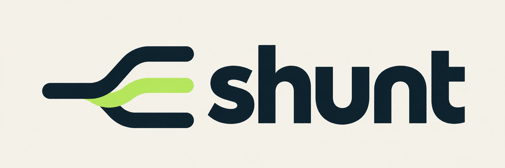

[](docs/production-readiness-review.md)
[](docs/api.md)
[](#windows-powershell-setup)
[](docs/evals/seven-api-validation.md)

Shunt is a **local coding-task router** that recommends which of three model tiers should handle a request. It uses a small LoRA adapter on **Qwen/Qwen3.5-0.8B** to score task complexity, then applies rules for scope, risk, ambiguity, and retries. Your application receives the recommendation and chooses what to do next.

- **Local inference:** Runs on a CUDA GPU with a locally trained adapter.
- **Three configurable tiers:** Route routine work to `T1`, standard work to `T2`, and complex or high-risk work to `T3`.
- **Seven API formats:** Hugging Face, vLLM, Open Inference Protocol, OPA decisions, Jev System One, OpenAI Chat Completions, and Anthropic Messages. [See contracts and SDK examples](docs/api.md).
- **Decision only:** Shunt does not invoke the recommended execution model. Its probabilities are uncalibrated, and its API supports a restricted subset of Jev's interface.

**Production readiness: not established.** The trained local prototype passes its bounded runtime checks, but the held-out scenarios do not establish generalization or deployment readiness. See the [review and proposed test balance](docs/production-readiness-review.md).

| Tier | Default recommendation | Responsibility |
| --- | --- | --- |
| T1 | [MiMo-V2.6-Distill-Qwen-9B](https://huggingface.co/XiaomiMiMo/MiMo-V2.6-Distill-Qwen-9B) | Routine, clearly specified edits with easy correctness checks. |
| T2 | [Qwen3.8-27B](https://huggingface.co/Qwen/Qwen3.8-27B) | Features, debugging, integrations, and module refactoring requiring repository context. |
| T3 | [DeepSeek-V4.1-Flash-1017](https://huggingface.co/deepseek-ai/DeepSeek-V4.1-Flash-1017) | Ambiguous, complex, or high-risk work and repeated lower-tier failures. |

Tiers describe responsibilities, not parameter ranges. These defaults are recommendations, not measured downstream success rankings. MiMo is an official Xiaomi research SFT checkpoint. All model mappings and connection settings are configurable; see [configuration](docs/configuration.md).

The adapter scores three label tokens in one forward pass. A pure policy layer applies scope floors, risk overrides, ambiguity promotion, and retry escalation. It does not call the three execution targets. See [architecture](docs/routing-architecture.md) and [training](docs/training.md).

The first trained adapter reached 34/36 on held-out synthetic prompts versus 24/36 for the frozen base. The bounded warm CUDA graph router measured 16.19 ms p95 over 1,000 fixture calls. See [results and limits](docs/evals/local-prototype.md); these are local prototype measurements.

The broader current 512-token warm acceptance run measured **25.41 ms p95 total**, with **22.98 ms inference** and **2.87 ms static processing**, across 1/2/8/9 supplied Python files. See [current acceptance and limits](docs/training.md#current-local-acceptance).

## Seven API formats

One local classifier and routing policy, exposed through seven established wire formats:

| Format | Endpoint |
| --- | --- |
| Hugging Face text classification | `POST /models/shunt` |
| vLLM classification | `POST /classify` |
| Open Inference Protocol HTTP/JSON | `POST /v2/models/shunt/infer` |
| OPA decision envelope | `POST /v1/data/shunt/route` |
| Jev System One | `POST /v1/systemone` |
| OpenAI Chat Completions | `POST /v1/chat/completions` |
| Anthropic Messages | `POST /v1/messages` |

See the **[API guide](docs/api.md)** for every request/response contract, SDK examples, streaming, batches, scope headers and supported subsets. The custom `POST /route` endpoint has been removed. These adapters return Shunt classification and routing decisions; coding-agent model execution requires a separate gateway. OPA is a fixed decision document, and Jev remains a fixed Choice question.

Try a routing decision once the service is running:

```powershell
Invoke-RestMethod http://127.0.0.1:18765/v1/chat/completions -Method Post -ContentType application/json -Headers @{'X-Shunt-File-Count'='1'; 'X-Shunt-Ast-Lines'='12'} -Body '{"model":"shunt","messages":[{"role":"user","content":"Fix a missing closing parenthesis."}]}'
```

Read `choices[0].message.content` as JSON for the selected tier and target. Raw probabilities are uncalibrated; policy overrides can select a higher tier. Model identifier: `shunt`.

## Docker Compose with NVIDIA GPU

Install Docker with Compose and NVIDIA GPU support ([Docker GPU setup](https://docs.docker.com/compose/how-tos/gpu-support/)); on Windows use Docker Desktop's Linux/WSL 2 backend and a compatible NVIDIA driver. From the repository root:

```sh
docker compose up --build -d
docker compose logs -f shunt
```

On first startup, the container downloads the pinned base model and trains the adapter on the GPU. Wait for `Shunt ready` in the logs; the image build, download and training require internet, substantial disk space and time. Docker also needs sufficient system memory in addition to GPU memory: a 3.8 GiB Docker Linux environment ran out of memory while building and training concurrently on this machine. If the container exits with code 137, check Docker/WSL memory limits and other running workloads. Named Docker volumes retain the model and adapter across container recreation. The service binds to `127.0.0.1:18765` on the host; set `SHUNT_DOCKER_PORT` in your shell or Compose `.env` before starting if that port is occupied. For example, in PowerShell: `$env:SHUNT_DOCKER_PORT='18766'; docker compose up --build -d`. Use the selected port in the requests below and in the API examples.

```sh
curl http://127.0.0.1:18765/health
curl -X POST http://127.0.0.1:18765/v1/data/shunt/route -H 'Content-Type: application/json' -d '{"input":{"task":"Fix a missing closing parenthesis.","scope":{"file_count":1,"ast_lines":12}}}'
docker compose down
```

`docker compose down` stops the service without removing its named volumes; run `docker compose up -d` to start it again. A local `.env` is optionally passed to the container for target configuration; `SHUNT_HOST` and `SHUNT_PORT` are fixed inside the container. Shunt returns target metadata and does not call those targets. If the default port is occupied by a host Shunt service, use a different `SHUNT_DOCKER_PORT`. The container needs an NVIDIA GPU; Ollama is not required to run Shunt. The API has no authentication; the published host port is restricted to loopback, but other containers on the same network can reach the service.

An interrupted model download resumes on the next start. If training is interrupted while saving the adapter, the container stops instead of overwriting it. Preserve the incomplete adapter and retry with:

```sh
docker compose run --rm --no-deps --entrypoint sh shunt -c 'test ! -e /app/artifacts/shunt-lora-incomplete && mv /app/artifacts/shunt-lora /app/artifacts/shunt-lora-incomplete'
docker compose up -d
```

If `shunt-lora-incomplete` already exists, choose a different destination in the command. To send the health and route requests from Windows PowerShell, use the `Invoke-RestMethod` examples in the Windows setup section below.

## Windows PowerShell setup

On Windows, install [uv](https://docs.astral.sh/uv/getting-started/installation/), an NVIDIA driver compatible with CUDA 12.8, and have an NVIDIA CUDA GPU available. From the repository root in PowerShell, run:

```powershell
.\scripts\setup.ps1
.venv/Scripts/python.exe -m shunt.server --cuda-graph
```

In a second PowerShell window, check the service and make a routing decision:

```powershell
Invoke-RestMethod http://127.0.0.1:18765/health
Invoke-RestMethod http://127.0.0.1:18765/v1/data/shunt/route -Method Post -ContentType application/json -Body '{"input":{"task":"Fix a missing closing parenthesis.","scope":{"file_count":1,"ast_lines":12}}}'
```

The setup script creates `.venv`, installs pinned dependencies, downloads the pinned base model, and trains the adapter if it is missing. If `.venv` already exists, the script installs into it and may change its packages; use a dedicated environment for this repository. It reuses existing model and adapter files; they remain local and are gitignored. A clean checkout needs internet access, substantial disk space for model weights, and GPU training time: no pretrained adapter is distributed, and first-run duration depends on your connection and GPU. The tested environment is Python 3.11, CUDA 12.8 PyTorch, and an RTX 5070 Ti. Stop the server with Ctrl+C. To use any supported format, follow its request in the [API guide](docs/api.md) once the server is running. Ollama is optional for the suggested downstream targets; it does not run Shunt itself.

If an interrupted download or training run leaves an incomplete directory, keep it for inspection by renaming it, then rerun setup. For example, for an incomplete base model:

```powershell
Rename-Item models/Qwen3.5-0.8B Qwen3.5-0.8B-incomplete
.\scripts\setup.ps1
```

For an incomplete adapter, rename `artifacts/shunt-lora` instead; setup will train a new one. Choose a different name if the suggested destination already exists.

## Configuration

Copy the example and edit it before starting the CLI or HTTP service:

```powershell
Copy-Item .env.example .env
```

By default, all three targets use an assumed local Ollama OpenAI-compatible endpoint at `http://127.0.0.1:11434/v1`. The example includes shared and per-tier model names, URLs (including ports), API keys, and timeouts, plus Shunt's own listening host and port. Existing process environment wins over `.env`; explicit server `--host` and `--port` win over both. Restart Shunt after edits.

The supplied model names are assumed local aliases, not verified Ollama registry tags. Create/import them on your model server or override the names. Shunt returns a decision and public `target` connection metadata; it does not download, serve, or invoke these execution models. Credentials are loaded for downstream integration and are excluded from responses. See the [full example and output contract](docs/configuration.md).

## Local HTTP service

With the existing downloaded base model and trained adapter, run from this repository root:

```powershell
$env:PYTHONPATH='.'
.venv/Scripts/python.exe -m shunt.server --cuda-graph
```

The resident process serves `GET http://127.0.0.1:18765/health` and the [seven decision interfaces](docs/api.md). It processes one GPU request at a time and rejects prompts exceeding its 512-token bucket. Scope is caller-declared; omitted scope triggers the existing unknown-scope escalation policy. This endpoint returns a routing decision; it does not execute the selected target model. Default binding is local loopback and has no authentication.

```powershell
Invoke-RestMethod -Uri http://127.0.0.1:18765/v1/data/shunt/route -Method Post -ContentType application/json -Body '{"input":{"task":"Fix a missing closing parenthesis.","scope":{"file_count":1,"ast_lines":12}}}'
```

The desktop-started instance writes logs under `tmp/http-service/`; it is a background process without automatic restart. Run the command above to restart after stopping it or rebooting. HTTP smoke checks covered a syntax request, retry escalation, invalid scope, and token overflow; this is local prototype operation, not production routing acceptance.


Current local launch received a [separate live review](docs/evals/http-service-launch-review.md), with [probe evidence](docs/evals/http-service-launch-probe.json). The reviewer checked the restart entry point with `--help`; it did not stop and restart the service.

## Evaluation and development

Optional evaluation, benchmarking, and tests:

```powershell
.venv/Scripts/python.exe scripts/evaluate.py --output artifacts/base-eval.json
.venv/Scripts/python.exe scripts/evaluate.py --adapter artifacts/shunt-lora --output artifacts/shunt-eval.json
.venv/Scripts/python.exe -m shunt 'Fix a typo in this module.' --scope-file shunt/policy.py --cuda-graph
.venv/Scripts/python.exe scripts/benchmark_router.py
.venv/Scripts/python.exe -m shunt 'Implement the existing endpoint pattern.' --files 3 --lines 100 --cuda-graph --graph-tokens 512
.venv/Scripts/python.exe scripts/audit_router.py
.venv/Scripts/python.exe scripts/acceptance_runtime.py
.venv/Scripts/python.exe -m pytest -q -p no:cacheprovider
```

Training uses authored synthetic policy labels. The validation set holds out intent templates; it does not prove routing quality on real coding tasks or the relative success rates of the execution targets. Probabilities are uncalibrated. The 30 ms p95 latency criterion remains a target until verified.

The public repository includes the training and validation data and the reviewed policy fixtures. Exploratory candidate datasets and their research-only scripts are kept outside the public checkout; some include third-party issue text with redistribution rights still under review.
