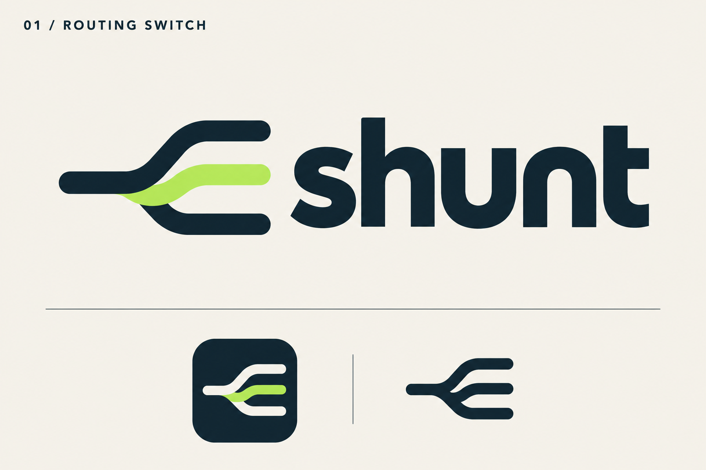
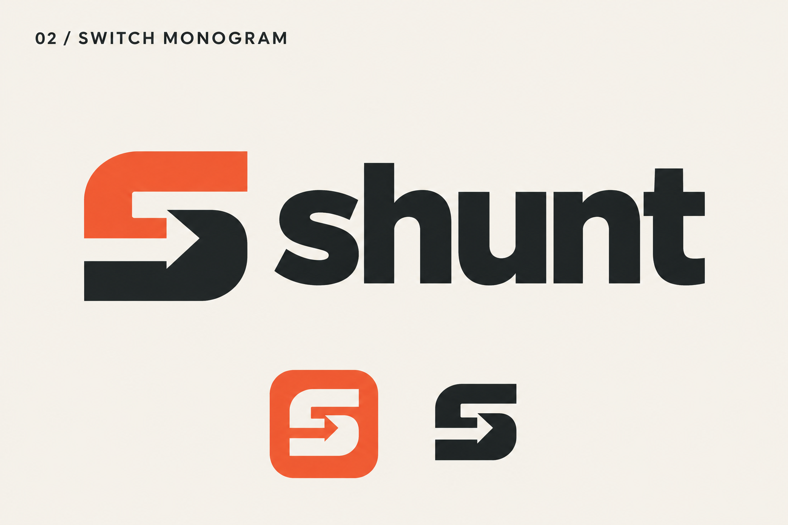

# Shunt identity

The owner selected **01 / Routing switch**. The README uses its clean horizontal logo: navy routing paths and wordmark, a signal-green center route, and a warm ivory background that keeps the mark readable in both GitHub themes. Artwork was created with the built-in image generation tool.

Primary file: `shunt-logo.png`. Badges are local SVG assets and link to the corresponding evidence or documentation.

Final editing prompt: extract only the main horizontal lockup from concept 01; preserve the routing symbol and lowercase wordmark; remove labels, dividing lines and specimen-sheet elements. Use a wide 3:1 canvas, solid warm ivory background, navy ink and the signal-green selected route. Transparent export variants were discarded because of edge artifacts.

The original directions below are retained as concept history.

## 01 / Routing switch

Prompt direction: one incoming track switches into three outgoing routes, one highlighted; midnight navy, signal green and warm ivory; lowercase shunt wordmark; Swiss identity sheet with small app icon and single-color variant. Flat vector-style concept, generous whitespace, no brain/robot or 3D imagery.

## 02 / Switch monogram

Prompt direction: architectural S formed from interlocking routing ribbons and arrow-like negative space; vermilion, graphite and warm ivory; lowercase shunt wordmark; identity sheet with app icon and monochrome variant. Flat vector-style concept, strong geometry, no brain/robot or 3D imagery.

The logo files and concept sheets are PNG artwork rather than editable vector masters.
